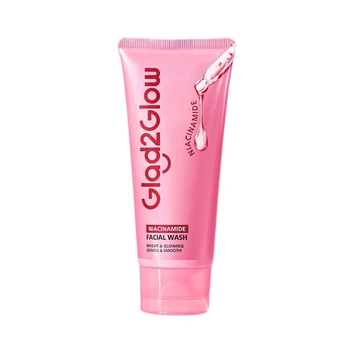
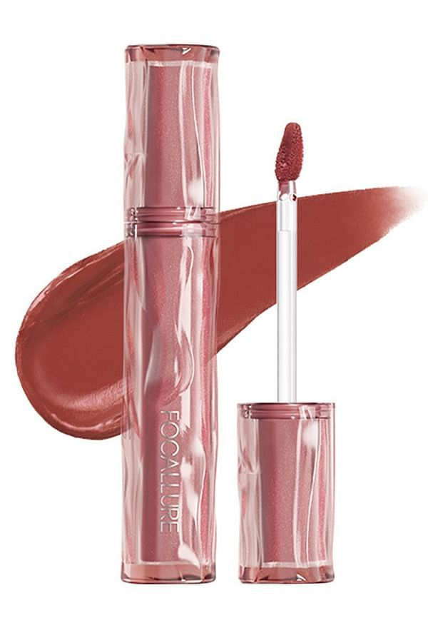
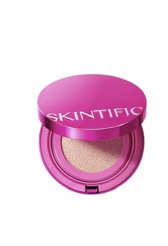
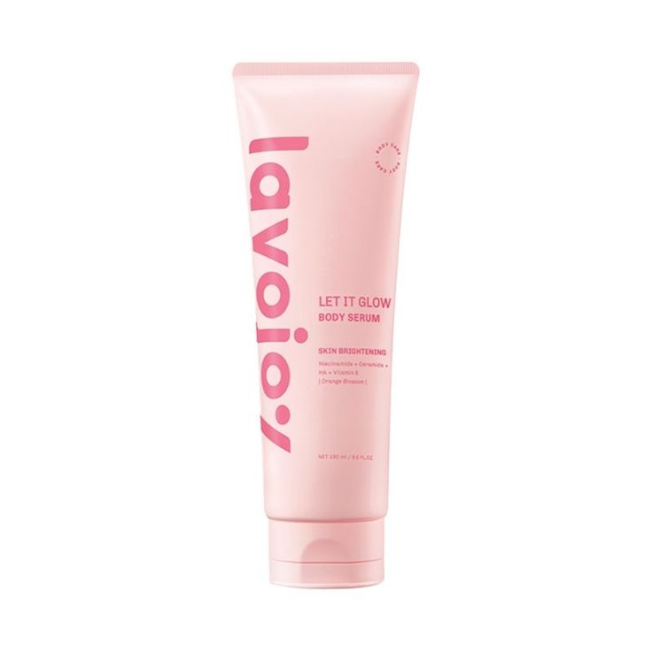

# GlowBeauty Store — Beauty E-Commerce

Proyek **Pemrograman Berbasis Web (PBW)** oleh:

- **AA Rangga** — 4524210001
- **Dina Camelia** — 4524210028

**Universitas Pancasila**

## Tentang Proyek

GlowBeauty Store adalah aplikasi web e-commerce sederhana untuk menampilkan dan menjelajahi produk kecantikan, seperti skincare, makeup, dan bodycare. Proyek ini mendemonstrasikan penggunaan PHP, array, perulangan, fungsi prosedural, serta pemrograman berorientasi objek (OOP) melalui halaman katalog, keranjang, checkout, dan panel admin.

## Struktur Folder

```text
UTS_PBW_B_Kelompok12/
├── assets/
│   ├── css/
│   │   └── style.css       # Gaya dan tata letak aplikasi
│   └── images/             # Gambar produk (.jpg)
├── classes/
│   ├── keranjang.php       # Class Keranjang untuk item dan total belanja
│   └── produk.php          # Class Produk dan pemeriksaan stok
├── includes/
│   ├── footer.php          # Footer bersama
│   ├── functions.php       # Fungsi format Rupiah, normalisasi, dan diskon
│   ├── header.php          # Header dan navigasi halaman utama
│   └── sample.php          # Data contoh produk
├── pages/
│   ├── admin.php           # Panel ringkasan inventaris
│   ├── checkout.php        # Ringkasan pembayaran dan diskon
│   ├── keranjang.php       # Ringkasan item keranjang
│   └── produk.php          # Katalog dan rating produk
├── index.php               # Halaman beranda
└── README.md
```

## Pembagian Fitur dan Implementasi

| Fitur | Implementasi |
|---|---|
| Katalog Produk | Perulangan `FOR` untuk menampilkan daftar produk. |
| Keranjang Belanja | Perulangan `WHILE` untuk menampilkan item dan class OOP `Keranjang` untuk menyimpan item serta menghitung total. |
| Rating Bintang | Nested loop `FOR` untuk menampilkan bintang sesuai nilai rating. |
| Checkout | Perulangan `DO-WHILE` untuk simulasi validasi pembayaran dan fungsi diskon prosedural. |
| Admin Panel | Class `Produk` sebagai model data produk dengan informasi dan status stok. |

## Showcase Gambar Produk / Fitur

| Facial Wash | Sunscreen | Lip Cream |
|---|---|---|
|  |  |  |

| Cushion | Body Lotion |
|---|---|
|  |  |

## Menjalankan Proyek Secara Lokal

### PHP Local Server

1. Pastikan PHP sudah terpasang dan tersedia di terminal.
2. Buka terminal pada folder proyek, lalu jalankan:

   ```bash
   php -S localhost:8000
   ```

3. Buka `http://localhost:8000` di browser.

### XAMPP

1. Salin atau letakkan folder proyek di dalam direktori `htdocs` XAMPP.
2. Jalankan Apache melalui XAMPP Control Panel. Proyek ini tidak memerlukan konfigurasi database.
3. Buka alamat berikut di browser:

   ```text
   http://localhost/UTS_PBW_B_Kelompok12/
   ```
